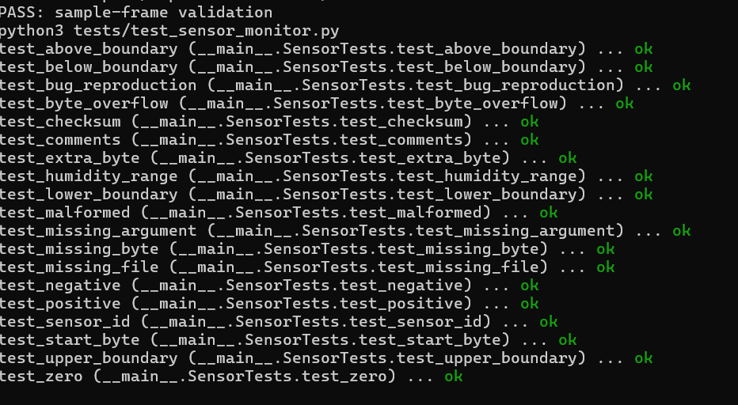
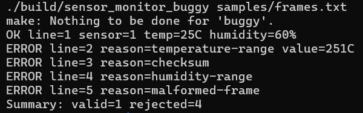
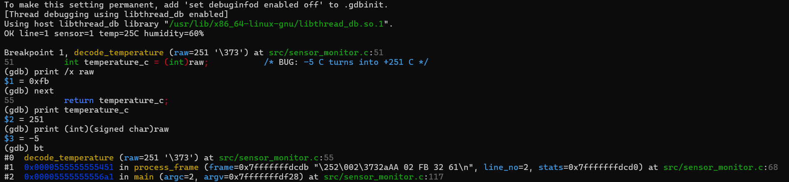
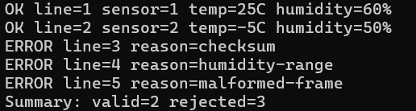

# Linux C Sensor Frame Debugger (GCC + GDB)

A small, **simulated** UART-style sensor packet-processing command-line program. No physical UART or sensor hardware is required. Designed for demonstrating C development, GCC compilation, GDB debugging, input validation, and reproducible testing on Linux.

## Packet format

Each line of input contains five hexadecimal bytes:

`AA SENSOR_ID SIGNED_TEMP_C HUMIDITY_PCT XOR_CHECKSUM`

- The start byte is `AA`.
- `SIGNED_TEMP_C` is a signed 8-bit, two's-complement integer (e.g., `FB` is -5 C).
- The XOR checksum covers the first **four** bytes only.
- Accepted temperatures: -40 through +85 C; humidity: 0 through 100%.
- Invalid start byte, checksum, sensor ID, temperature, humidity, and malformed lines are rejected.

## 1. Install compiler and debugger (Ubuntu/Debian)
```bash
sudo apt update
sudo apt install build-essential gdb python3 git
```

## 2. Compile and test on Linux

```bash
make
./build/sensor_monitor samples/frames.txt
make test
```

The fixed build prints two valid packets (including a **-5 C** reading) and three rejected packets. `make test` uses `diff` to verify exact output.

## 3. Reproduce an intentional bug

```bash
make buggy
./build/sensor_monitor_buggy samples/frames.txt
```

The second frame (`AA 02 FB 32 61`) represents **-5 C**, but the buggy build interprets `FB` (hex) as unsigned **251 C**, then incorrectly rejects the packet.

## 4. Debug with GDB

```bash
gdb --args ./build/sensor_monitor_buggy samples/frames.txt
```

At the `(gdb)` prompt, enter commands **one per line**:

```gdb
break decode_temperature if raw == 251
run
print raw
next
print temperature_c
print (signed char)raw
list
bt
quit
```

Expected diagnosis: `raw` is 251, `temperature_c` is 251 in the buggy branch, but `(signed char)raw` is -5. GDB allows you to inspect program values at the breakpoint and reveal the unsigned/signed conversion error.

## 5. Fix and confirm

The source has a compile-time switch to show the difference:

- With `-DINTRODUCE_BUG`: `int temperature_c = (int)raw;` (**wrong**).
- Without that flag: `int temperature_c = (int)(int8_t)raw;` (**correct** for GCC on standard Linux targets).

`make` produces the fixed build. Run `make test` to confirm valid negative temperatures are decoded correctly.


## 6. Useful GCC flags

- `-g3`: include rich debug information for GDB.
- `-O0`: avoid optimization so variables and control flow are easier to inspect.
- `-Wall -Wextra -Wpedantic -Werror`: surface and enforce compile-time warnings.
- `-std=c11`: compile as C11.

## 7. Software Validation Results

The application was compiled and tested in Ubuntu using Windows Subsystem for Linux (WSL) and Visual Studio Code.

### Development Environment

| Tool | Version |
|---|---|
| GCC | 15.2.0 |
| GNU Make | 4.4.1 |
| GDB | 17.1 |
| Python | 3.14.4 |
| Git | 2.53.0 |

### Automated Regression Testing

All 19 automated regression tests passed successfully.

| Test Category | Passed |
|---|---:|
| Valid readings and boundary conditions | 5/5 |
| Out-of-range measurements | 3/3 |
| Protocol validation | 3/3 |
| Malformed packet detection | 4/4 |
| Comments and blank lines | 1/1 |
| Command-line error handling | 2/2 |
| Intentional bug reproduction | 1/1 |
| Total | 19/19 |



### Intentional Bug Reproduction

The intentionally buggy executable incorrectly interprets the hexadecimal temperature byte 0xFB as 251°C instead of -5°C.



### GDB Root Cause Analysis

A conditional breakpoint was used to isolate the negative-temperature packet and inspect the signedness conversion.

| Debugging Parameter | Observed Value |
|---|---|
| Raw hexadecimal byte | 0xFB |
| Incorrect unsigned interpretation | 251 |
| Correct signed interpretation | -5 |
| Root cause | Incorrect signedness conversion |



### Corrected Implementation

The corrected implementation converts the raw temperature byte through int8_t before converting it to an integer.



### Technical Documentation

- [Sensor communication protocol](docs/protocol.md)
- [GDB debugging and root cause analysis](docs/debugging.md)
- [Software validation results](docs/validation.md)

The project demonstrates simulated sensor packet processing, software debugging, error detection and automated regression testing. Physical UART communication and comprehensive fuzz testing are outside the scope of this implementation.

## What you can accurately claim

After personally executing the GDB workflow on Linux, you can describe **compiled and debugged a C sensor-frame parser with GCC/GDB; inspected a signedness bug with conditional breakpoints; implemented checksum/range validation and automated sample testing**.

Do **not** claim physical UART communication: the input comes from a text file and only *simulates* UART-like packet payloads.
