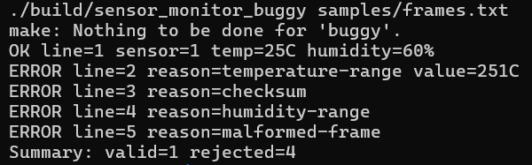
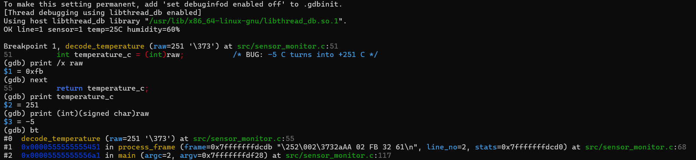
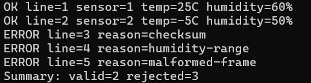

# GDB Debugging and Root Cause Analysis

## 1. Defect Description

The intentionally buggy executable interprets negative temperature bytes as unsigned integers.

The hexadecimal value 0xFB represents -5°C in signed 8-bit two's-complement representation but is incorrectly interpreted as 251°C by the buggy implementation.

## 2. Bug Reproduction

```bash
make buggy
./build/sensor_monitor_buggy samples/frames.txt
```

Observed output:

```text
OK line=1 sensor=1 temp=25C humidity=60%
ERROR line=2 reason=temperature-range value=251C
ERROR line=3 reason=checksum
ERROR line=4 reason=humidity-range
ERROR line=5 reason=malformed-frame
Summary: valid=1 rejected=4
```



## 3. GDB Debugging Procedure

```bash
gdb --args ./build/sensor_monitor_buggy samples/frames.txt
```

GDB commands:

```gdb
break decode_temperature if raw == 251
run
print /x raw
next
print temperature_c
print (int)(signed char)raw
bt
```

## 4. Observed Debugging Results

```text
$1 = 0xfb
$2 = 251
$3 = -5
```

The conditional breakpoint successfully isolated the problematic sensor frame.



## 5. Function Call Stack

```text
main()
  -> process_frame()
      -> decode_temperature()
```

The call stack identified the temperature decoding function as the location of the defect.

## 6. Root Cause

The unsigned temperature byte was directly converted to an integer.

Incorrect implementation:

```c
int temperature_c = (int)raw;
```

Corrected implementation:

```c
int temperature_c = (int)(int8_t)raw;
```

The corrected implementation preserves the intended signed temperature representation on the tested GCC Linux target.

## 7. Fix Verification

```bash
./build/sensor_monitor samples/frames.txt
make test
```



All 19 automated regression tests passed, including negative-temperature decoding and intentional bug reproduction.

## 8. Conclusion

The defect was successfully reproduced, isolated and diagnosed using GCC and GDB. The corrected signed conversion was verified through automated regression testing.
