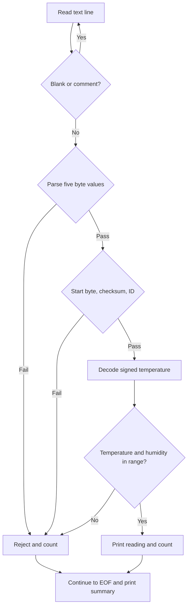

# Simulated sensor protocol

Each input line holds five hexadecimal byte values: start (AA), sensor ID (1–255), signed two's-complement temperature in Celsius, humidity percentage, and XOR checksum of the first four bytes. Temperature range is -40 to 85°C; humidity range is 0–100%.

Example: `AA 02 FB 32 61` decodes to sensor 2, -5°C and 50% humidity. `AA XOR 02 XOR FB XOR 32 = 61` (hex).

Validation order: malformed line, start byte, checksum, zero sensor ID, temperature, humidity. This is a file-driven simulation, not a UART driver. XOR detects some corruption but is not a CRC or cryptographic integrity check. The existing parser uses sscanf and a fixed-size line buffer; strict token grammar, very long lines, and hostile input are not comprehensively handled.
