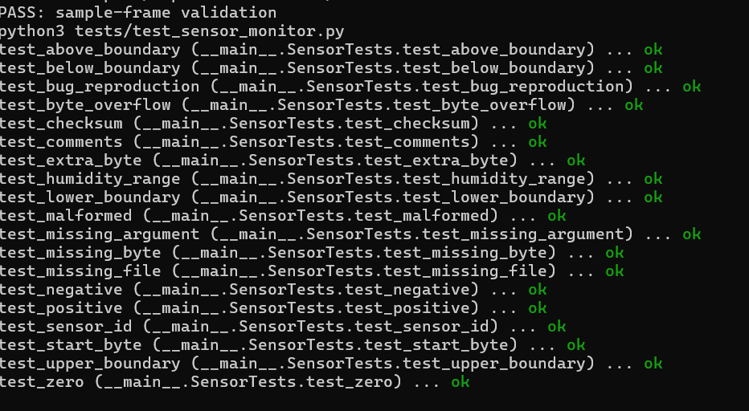

# Software Validation and Regression Test Results

## Objective

Validate the sensor frame parser, verify protocol compliance, test boundary conditions and confirm the signedness defect reproduction.

## Test Environment

- Operating environment: Ubuntu through WSL
- Development environment: Visual Studio Code
- GCC: 15.2.0
- GNU Make: 4.4.1
- GDB: 17.1
- Python: 3.14.4
- Git: 2.53.0

## Test Execution

```bash
make clean
make test
```

The test procedure builds the corrected and intentionally buggy executables, compares the sample output against the expected output and executes the Python regression suite.

## Regression Test Results

| Test ID | Test Description | Status |
|---|---|---|
| TC-01 | Positive temperature | Passed |
| TC-02 | Negative temperature | Passed |
| TC-03 | Zero temperature and humidity | Passed |
| TC-04 | Lower temperature boundary | Passed |
| TC-05 | Upper temperature and humidity boundary | Passed |
| TC-06 | Below minimum temperature | Passed |
| TC-07 | Above maximum temperature | Passed |
| TC-08 | Invalid humidity range | Passed |
| TC-09 | Invalid start byte | Passed |
| TC-10 | Invalid checksum | Passed |
| TC-11 | Invalid sensor ID | Passed |
| TC-12 | Malformed frame | Passed |
| TC-13 | Missing byte | Passed |
| TC-14 | Extra byte | Passed |
| TC-15 | Byte overflow | Passed |
| TC-16 | Comments and blank lines | Passed |
| TC-17 | Missing command-line argument | Passed |
| TC-18 | Missing input file | Passed |
| TC-19 | Intentional signedness bug reproduction | Passed |

## Test Summary

- Total tests: 19
- Passed: 19
- Failed: 0
- Pass rate: 100%



## Engineering Analysis

The regression suite confirms the expected behavior for valid sensor packets, invalid measurements, malformed inputs and command-line errors.

The negative-temperature regression test verifies correct signed interpretation of the temperature byte.

The bug-reproduction test confirms that the deliberately buggy executable exhibits the intended signedness defect.

## Limitations

The tests use simulated sensor packets supplied through text files. Physical UART communication, hardware sensor accuracy, real-time performance and comprehensive fuzz testing have not been validated.

## Conclusion

All 19 implemented automated regression tests passed successfully. The results establish correct behavior for the tested input scenarios.
